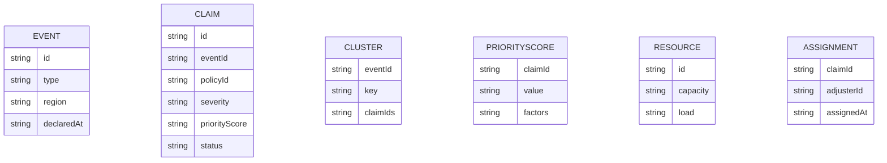

# Data model — INS-04 · CAT Claims Surge Portal
<!-- Complete on Day 2 from the BRD's 'core data entities'. Normalise. Handle PII. -->

## Entities (seeded from the brief — refine them)
- Event (id, type, region, declaredAt)
- Claim (id, eventId, policyId, severity, priorityScore, status)
- Cluster (eventId, key, claimIds[])
- PriorityScore (claimId, value, factors[])
- Resource/Adjuster (id, capacity, load)
- Assignment (claimId, adjusterId, assignedAt)

## ERD (fill in the fields, keys, and relationships)

## Entity detail
### Event

| Field | Type | Required | Key |
|---|---|---|---|
| id |  |  | PK/FK? |
| type |  |  | PK/FK? |
| region |  |  | PK/FK? |
| declaredAt |  |  | PK/FK? |
### Claim

| Field | Type | Required | Key |
|---|---|---|---|
| id |  |  | PK/FK? |
| eventId |  |  | PK/FK? |
| policyId |  |  | PK/FK? |
| severity |  |  | PK/FK? |
| priorityScore |  |  | PK/FK? |
| status |  |  | PK/FK? |
### Cluster

| Field | Type | Required | Key |
|---|---|---|---|
| eventId |  |  | PK/FK? |
| key |  |  | PK/FK? |
| claimIds |  |  | PK/FK? |
### PriorityScore

| Field | Type | Required | Key |
|---|---|---|---|
| claimId |  |  | PK/FK? |
| value |  |  | PK/FK? |
| factors |  |  | PK/FK? |
### Resource

| Field | Type | Required | Key |
|---|---|---|---|
| id |  |  | PK/FK? |
| capacity |  |  | PK/FK? |
| load |  |  | PK/FK? |
### Assignment

| Field | Type | Required | Key |
|---|---|---|---|
| claimId |  |  | PK/FK? |
| adjusterId |  |  | PK/FK? |
| assignedAt |  |  | PK/FK? |

## Notes
- Mark every **key** (PK/FK) and every **relationship** with its cardinality.
- Call out any **PII** fields and how you protect them (masking in logs, access control).
- Keep a migration/seed script in version control so anyone can recreate the DB.
